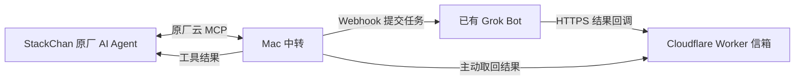

# StackChan × Grok Bot

让 StackChan 把明确转交的问题交给已有的 Grok Bot，收到结果后，继续使用设备原厂音色自动朗读。

Mac 负责中转，StackChan 继续使用原厂 AI Agent 的模型、语音和设备控制能力。Grok Bot 沿用自己的身份、记忆、工具与审批要求。无需给机器人刷写定制固件。

## 已跑通的效果

- 说“帮我问格洛克：……”后，机器人提交一次任务，自动查询并读出结果，无需再问“它怎么说”。
- 等待过程中使用原厂语音播报进度，最终答复也使用原厂音色。
- `until_result` 模式通过多次短工具调用持续等待，中转不设置总等待时长或续查次数上限。
- 可以查询已有结果，或说“停止等待格洛克”停止本机等待；停止等待不会撤销已经交给 Bot 的任务。
- Cloudflare Worker 接收回调，Mac 主动取回结果，无需开放 Mac 的公网端口，也无需自有域名。

一次实机长任务测试中，任务只提交了 **1 次**，经过 **18 次自动续查**，约 **173 秒**后由机器人自动读出结果，全程无需追问。设备固件为 v1.6.0。实现和验证过程见 [经验记录](docs/EXPERIENCE.zh-CN.md)。

## 连接方式



自动续查发生在原厂 AI Agent 的当前会话中：每次工具调用最多等待 4.5 秒，未完成时返回任务编号和续查凭据，让 Agent 先朗读进度，再继续查询同一任务。Mac 需保持唤醒、联网，机器人也需联网；两者可以使用不同网络。

## 准备环境

- 支持 MCP 接入点的 StackChan 原厂 AI Agent。
- 已有 Grok Bot，并能创建 webhook 触发的 routine、发送 HTTP 回调。
- Node.js 22 或以上、Python 3、POSIX 环境；登录常驻服务脚本用于 macOS。
- Cloudflare 账号，使用 Worker 的 `workers.dev` 地址。

本项目继续使用设备原厂提供的模型和语音服务。Grok Bot 与 Cloudflare 的使用条件、额度和费用以各自账号及服务政策为准。

## 配置与启动

在项目目录执行：

```sh
npm install
chmod +x stackchan
cp bridge.example.json bridge.local.json
chmod 600 bridge.local.json
```

编辑 `bridge.local.json`，填写设备 App 中复制的完整 `mcpEndpoint`，并为 `relayMasterToken` 设置独立的随机密钥。该密钥须为 32–128 个字母、数字、下划线或连字符，不能与 Grok webhook key 共用。示例已启用 `"automaticWaitMode": "until_result"`，保留正数 `replyWaitMs`。

部署回调信箱：

```sh
./stackchan cloudflare prepare
./stackchan cloudflare login
./stackchan cloudflare check
./stackchan cloudflare deploy
```

具体部署步骤见 [Cloudflare 配置说明](cloudflare/DEPLOY.md)。部署工具会将 Worker 地址写入本地配置，并生成 `.local/grok-routine-ready.txt`。

将生成的指令交给要连接的 Grok Bot，创建只通过 webhook 触发的 routine。把 routine 详情里的 Webhook **POST to** 和 **key** 分别填入本地配置的 `grokWebhookUrl`、`grokWebhookKey`。生成的 routine 指令包含回调规则和允许地址，不应包含中继主密钥。

检查并运行：

```sh
./stackchan doctor
./stackchan start
```

设备进入 AI Agent 后，可以说：

> 帮我问格洛克：请用一句中文跟我打个招呼。

等待时保持当前会话，让机器人自动续查。使用明确的“问格洛克”前缀，可以把任务交给 Bot；普通聊天、提醒和设备控制仍由原厂 Agent 处理。

另开终端查看连接状态：

```sh
./stackchan status
```

需要 macOS 登录后常驻时，先正常结束手动运行的中转，再执行：

```sh
./stackchan service prepare
./stackchan service install
./stackchan service status
```

卸载常驻服务使用 `./stackchan service uninstall`。若项目在外置磁盘上，保持磁盘挂载，并按 macOS 提示授予后台 Node 读取该目录的权限。

## 验证

```sh
./stackchan test
```

118 项离线测试全部通过，覆盖配置、回调认证、任务持久化、续查与取消、MCP 协议及单实例互斥。它们不调用真实 Grok Bot。

配置 Cloudflare 后，可额外运行：

```sh
node scripts/verify-relay.mjs
```

这个检查会向自己的回调信箱写入并取回一条测试结果，验证错误凭据被拒绝以及确认后清理结果；不会触发 Grok Bot。最后仍需用机器人实测，确认实际听到语音。

## 配置与隐私

`bridge.local.json`、`.state/`、`.local/` 和日志仅用于本机运行，不应提交。MCP 完整地址可能带登录凭据，Webhook key、中继主密钥和任务回调 token 也应视为密钥。

本仓库只包含通用源码、空白配置模板、测试和部署说明。分享排查信息时，请先移除凭据、设备标识、个人目录、真实任务内容及回调地址。

## 文件入口

| 文件 | 用途 |
| --- | --- |
| `bridge.mjs` | 中转启动、MCP 连接、运行状态 |
| `lib/mcp.mjs` | 工具定义、任务续查及进度朗读提示 |
| `lib/jobs.mjs` | 任务提交、回调结果与本地持久化 |
| `lib/voice.mjs` | 每次工具调用的短等待 |
| `cloudflare/worker.mjs` | HTTPS 回调信箱 |
| `grok-routine.txt` | Grok Bot routine 指令模板 |
| `scripts/service.mjs` | macOS 登录常驻服务 |

